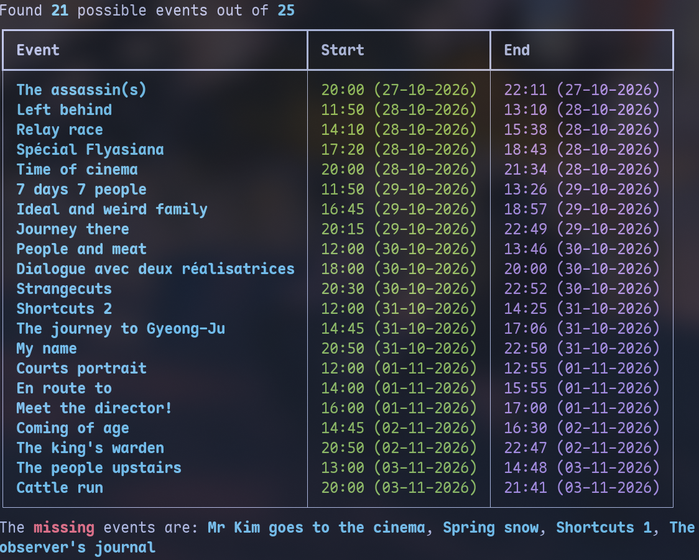

# atfest


_Movies were picked randomly as an example_.

For some particular movie festival, it is not direct to make a program because movies can be screened **multiple times** during the period and also two movies can be screened **at the same time**.
This project aims to translate this problem as an [optimization problem](https://en.wikipedia.org/wiki/Optimization_problem) and solve it.

One assumption I add is that I only want to watch a movie once at best (to discover other movies).

If you are interested in the mathematical details, please check the [blog post](https://rx342.xyz/blog/atfest/).

> [!Warning]
> [Schedules](./schedules/) were done manually so it may contain mistakes, feel free to open an issue/PR if needed.

> [!Caution]
> This project is made for fun and I don't plan to generalize it for other purposes than my own.

## Requirements

- `python3`
- [`uv`](https://docs.astral.sh/uv/getting-started/installation/)
- Optional: [`nix`](https://nixos.org/) (provides the above in [`default.nix`](./default.nix))

## Usage

### Create a schedule

```bash
uv run atfest --input schedules/new.json new
```

### Find the optimal schedule

```bash
uv run atfest --input schedules/new.json solve
```
